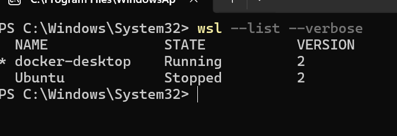
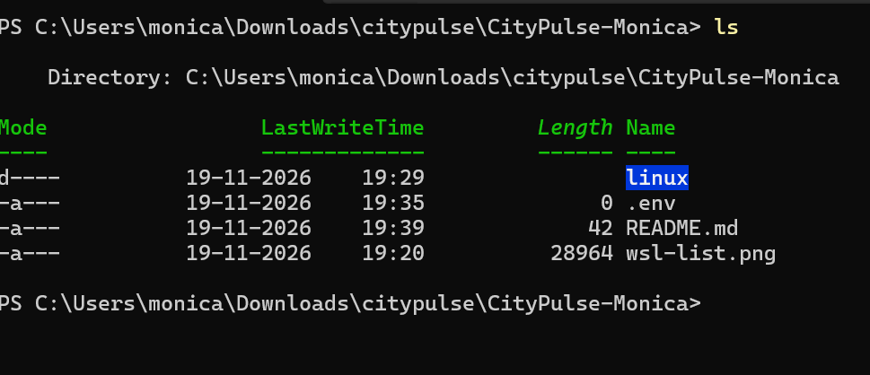
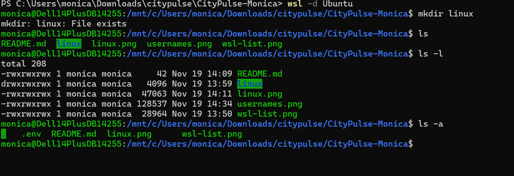
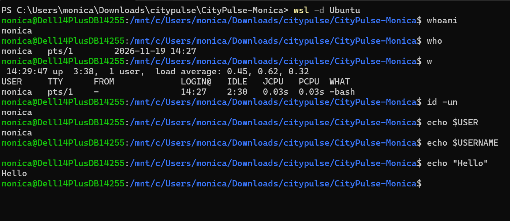
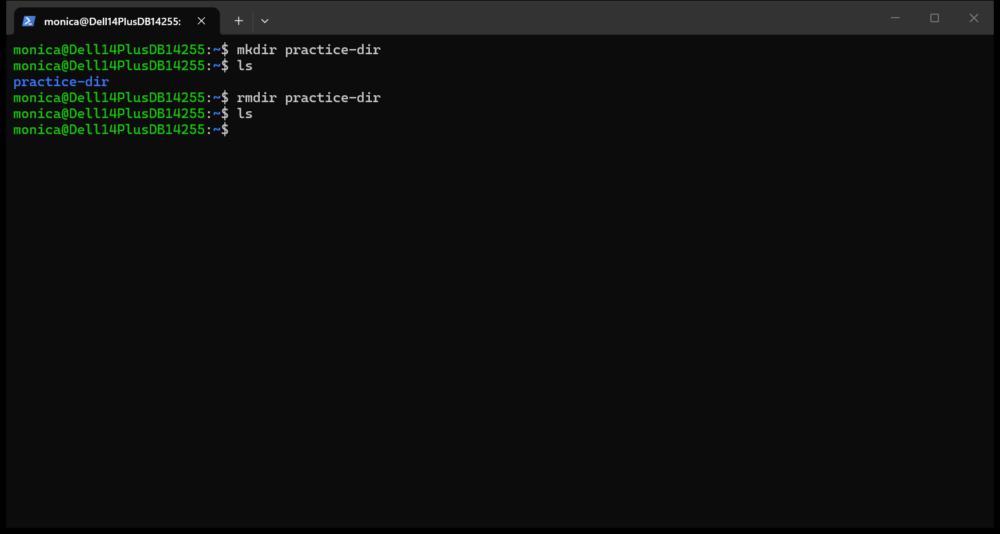
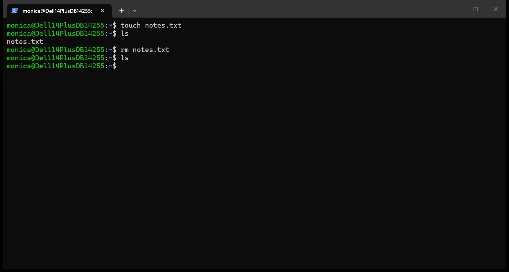
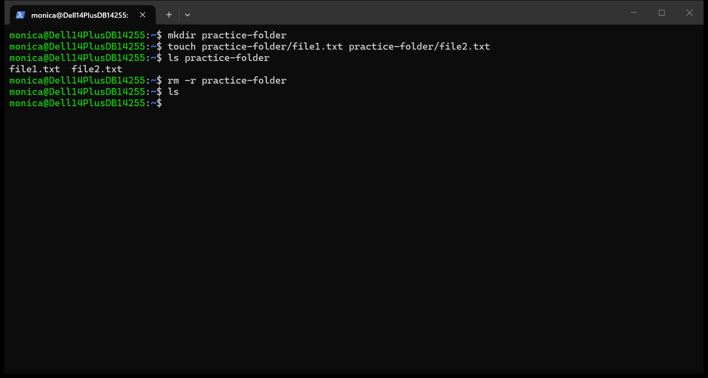
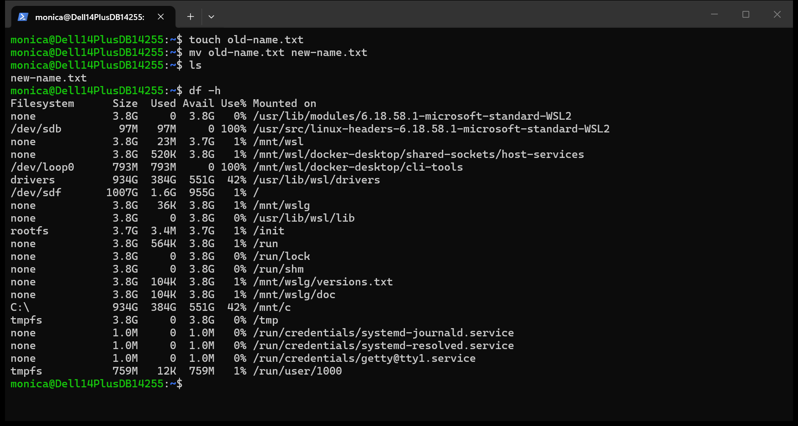
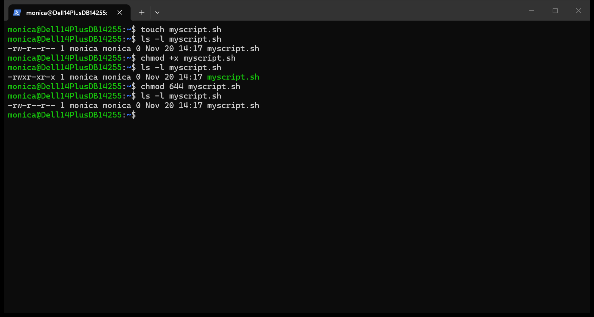
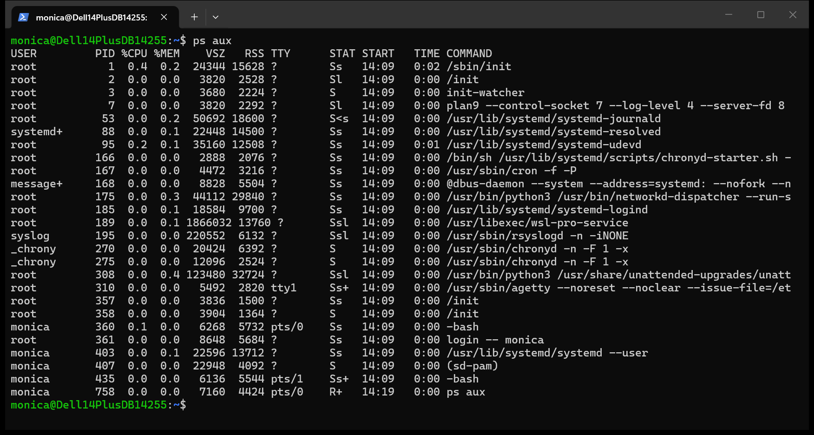

# CityPulse

Linux command-line practice on WSL, with a screenshot of each task.

## WSL Check

Check that WSL is installed and list the Linux distributions.

```powershell
wsl --list --verbose
```



## Project Setup: Folder, Hidden File and Listing

Create a folder, create a hidden `.env` file, and list files in different ways.

```powershell
ls
```

```bash
mkdir linux
ls
ls -l   # long format: permissions, owner, size, date
ls -a   # also shows hidden files such as .env
```




## User and Login Information

```bash
whoami        # current user name
who           # who is logged in
w             # logged-in users and what they are running
id -un        # user name from the user ID
echo $USER    # USER environment variable
echo "Hello"  # print text
```



## Task 1: Create and Remove a Directory

`mkdir` creates a directory. `rmdir` removes it, but only when it is empty.

```bash
mkdir practice-dir
ls
rmdir practice-dir
ls
```



## Task 2: Remove a File

`touch` creates an empty file. `rm` deletes it.

```bash
touch notes.txt
ls
rm notes.txt
ls
```



## Task 2.1: Remove a Folder and Everything Inside It

`rm -r` deletes a folder together with all its files.

```bash
mkdir practice-folder
touch practice-folder/file1.txt practice-folder/file2.txt
ls practice-folder
rm -r practice-folder
ls
```

> `rm -r` deletes permanently. Check the name before pressing Enter.



## Task 3: Rename a File and Check Disk Usage

`mv` renames a file. `df -h` shows disk space in a readable format (G, M).

```bash
touch old-name.txt
mv old-name.txt new-name.txt
ls
df -h
```



## Task 4: File Permissions

Every file has read (`r`), write (`w`) and execute (`x`) permissions for the owner, the group and other users.

```bash
touch myscript.sh
ls -l myscript.sh
chmod +x myscript.sh
ls -l myscript.sh
chmod 644 myscript.sh
ls -l myscript.sh
```

| Mode | Meaning |
| --- | --- |
| `644` | Owner can read/write; everyone else can only read |
| `755` | Owner can read/write/execute; everyone else can read/execute |
| `777` | Everyone can read, write and execute |



## Task 5: List Running Processes

`ps aux` lists every process running on the system.

```bash
ps aux
```


